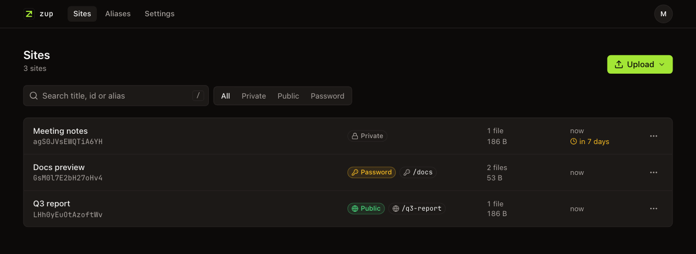

<p align="center">
  
</p>

<h1 align="center">zup</h1>

<p align="center">Self-hosted publishing for static files and sites. Run <code>zup ./dist</code> and get a URL.</p>

- **CLI** — uploads only new content (content-addressed) and prints the URL.
- **Access** — private (only you), public, or password (with share links that unlock without typing).
- **Aliases** — stable names like `https://preview.example.com/report/` that you move to a new upload.
- **Expiry** — `--expires 7d`; expired uploads are deleted.
- **Dashboard** — list, search, drag-and-drop upload, access, aliases, share links, sessions, passkeys.
- **MCP** — Claude Code / Claude Desktop can publish pages for you, with OAuth login.



One owner account (the first one created). Built with Bun, Hono, Better Auth, SQLite and React.

## CLI

Install it from your server (needs Node.js 20+) and log in:

```sh
curl -fsSL https://zup.example.com/install.sh | sh
zup login https://zup.example.com    # approve the code in the dashboard
```

```sh
zup ./dist                           # private site
zup report.html --public | --protect | --password 'correct horse battery'
zup ./dist --alias demo --public     # also at https://preview.example.com/demo/
zup ./dist --alias demo --update     # move the alias to the new upload (keeps its access)
zup notes.md -e 7d                   # delete after 7 days

zup ls [search]                      # --access public|private|password, --json
zup info | open | share <site>       # share: new share link for a password site
zup access <site> --private          # or --public, --protect, --password <key>
zup alias <site> demo                # zup unalias demo to remove
zup expire <site> never              # or 30m, 12h, 7d, 2w, a date
zup rename <site> "Q3 report"
zup rm <site>...
zup pull demo ./copy                 # download files, verified by SHA-256
zup upgrade                          # latest CLI from your server
```

`<site>` is a deployment id, an alias, or a site URL. `--protect` generates a password and prints
it once with a share link. Run `zup --help` for every option.

Uploading a folder skips `.git`, `node_modules`, `.env*` (except `.env.example`), `.npmrc`,
`.DS_Store`, `.gitignore` matches and `.zupignore` matches. `index.html` (or `index.md`, or the
only file) is the root. Unknown extensionless paths serve the root page (SPAs); turn off with `--no-spa`.

Environment: `ZUP_SERVER`, `ZUP_TOKEN` (for CI), `ZUP_PASSWORD` (used by `--protect`).

## Access

A deployment and each alias have their own access: private (default), public, or password.

**Password sites** remember a correct password for 30 days. Share links (`…/#password=…` or
`…/#token=…`) unlock without typing; the part after `#` never reaches the server. Only a hash is
stored, so a lost password cannot be shown again — `zup share` makes a new working link. Setting a
new password ends all old links and cookies.

**Private sites** use your dashboard session. Logging out (or revoking the session) ends access.

## MCP (Claude Code, Claude Desktop)

```sh
claude mcp add --transport http zup https://zup.example.com/mcp
```

Then run `/mcp` in Claude Code to log in. In Claude Desktop, add a custom connector with the same
URL. Passwords for password access are always generated by the server.

## Deploy

zup is one Docker container that serves two hosts:

| Variable | Example | Serves |
| --- | --- | --- |
| `APP_URL` | `https://zup.example.com` | Dashboard, API, CLI login, MCP, `install.sh` |
| `PREVIEW_URL` | `https://preview.example.com` | Uploaded sites: `/u/<id>/` and `/<alias>/` |

You need:

1. DNS for both hosts pointing to your server.
2. A reverse proxy with TLS (Caddy, Traefik, nginx) that sends both hosts to the container on port `3000`.
3. A persistent volume at `/data`.

```sh
docker build -t zup .
docker run -d --restart unless-stopped -p 127.0.0.1:3000:3000 -v zup-data:/data \
  -e APP_URL=https://zup.example.com -e PREVIEW_URL=https://preview.example.com \
  -e BETTER_AUTH_SECRET=$(openssl rand -hex 32) zup
```

Then open `APP_URL` and create your account. Sign-up closes after that.

- Keep `BETTER_AUTH_SECRET` stable. Changing it logs everyone out and ends share links and MCP logins.
- The proxy must set `X-Forwarded-For` (used for rate limits). Without a proxy, set `CLIENT_IP_HEADER=`.
- The container runs as uid 1000; a bind mount for `/data` must be writable by it.
- Backups: `sqlite3 /data/zup.db ".backup /backup/zup.db"`, then copy `/data/blobs`.

### Coolify

Create a resource from this repo with the **Dockerfile** (or **Docker Compose**) build pack. Set
domains to `https://zup.example.com,https://preview.example.com`, port `3000`, add a volume at
`/data`, and set the three variables above. Coolify's proxy handles TLS and `X-Forwarded-For`.

### Configuration

| Variable | Default | |
| --- | --- | --- |
| `APP_URL` | required | Dashboard/API URL |
| `PREVIEW_URL` | required | Sites URL, different host |
| `BETTER_AUTH_SECRET` | required | 32+ random characters |
| `DATA_DIR` | `/data` (Docker) | Database and files |
| `MAX_FILE_BYTES` | 1 GiB | Per file |
| `MAX_DEPLOYMENT_BYTES` | 4 GiB | Per upload |
| `MAX_FILES` | 10000 | Per upload |
| `MCP_MAX_BODY_BYTES` | 64 MiB | Per MCP request |
| `CLIENT_IP_HEADER` | `x-forwarded-for` | Client IP header for rate limits. Empty: socket address |

## Notes

- **Security.** Uploaded HTML runs JavaScript on the preview host. It cannot use your dashboard
  session, but all sites share that host, so a page can read any other site the same visitor can
  open (for you: all of them). Only publish HTML you trust.
- **Sites built for `/`.** Root-relative URLs (`/assets/app.js`) still work: zup uses the
  `Referer` to redirect into the right site. Relative paths are better (Vite: `base: "./"`).

## Development

```sh
bun install
cp .env.example .env   # set APP_URL=http://localhost:5173, PREVIEW_URL=http://127.0.0.1:3000
bun --env-file=.env apps/server/src/index.ts   # API + sites on :3000
bun run --filter @zup/web dev                  # dashboard on :5173 (proxies the API)
bun packages/cli/src/index.ts --help           # CLI from source
```

Checks: `bun run typecheck`, `bun run lint`, `bun test`. Schema changes: edit
`apps/server/src/db/schema.ts`, then `bun run --filter @zup/server db:generate`.

## License

[MIT](LICENSE)
